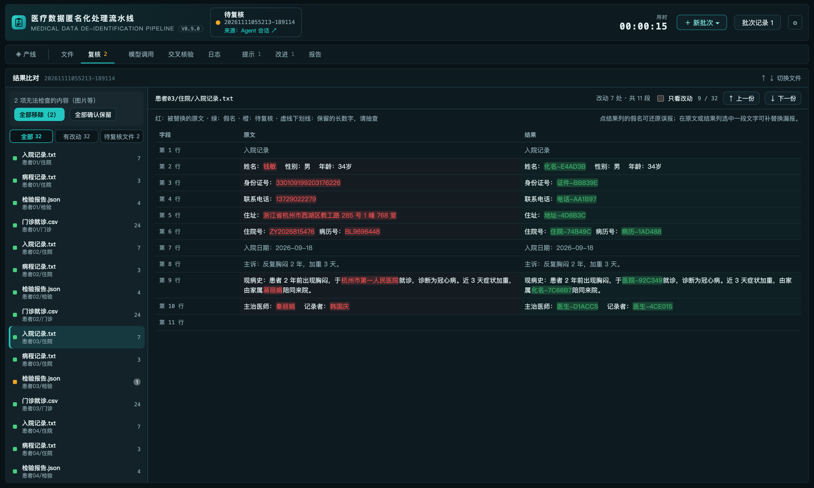

# dsh-medical-anonymizer

[简体中文](README.md) | **English**

A [DeepSeek Harness](https://github.com/deepseek-ai/deepseek-harness) plugin for batch de-identification of medical records,
tables, and DICOM metadata. It finds direct identifiers, replaces them with stable pseudonyms, keeps the file structure
intact, and writes an audit report plus a re-identification vault.

> This is a data-processing tool, not a compliance certification. Review the applicable law and your institution's
> policy before publishing any output.


<sub>Screenshots use synthetic data; no real patient information. The interface follows the Harness locale (Chinese or English).</sub>

## Highlights

- **Structure preserved**: the model only annotates text; the plugin locates and replaces exact spans. Line counts, CSV
  columns, JSON keys, and non-text Excel cells do not move.
- **Rules first, model optional**: ID checksums, phone, email, labeled fields, and column/key policies need no model; a
  model adds recall on free text and re-checks the result.
- **Two-model cross-check**: blind review plus re-judging in a bounded repair loop; what cannot be resolved goes to
  manual review instead of being accepted silently.
- **Local-first**: no telemetry; only the OpenAI-compatible endpoint you configure is contacted.
- **Auditable**: per-file counts, structure checks, a review list; the report never prints original values, which live
  only in the vault.

| Area | What it does |
| --- | --- |
| Formats | `.txt` `.md` `.csv` `.json` `.xlsx`, `.zip` (nested too), DICOM (metadata only); encoded content in fields (base64, HTML, nested JSON …) is unwrapped and checked |
| Identifiers | names, doctors/staff, Chinese IDs, phone, email, address, record/admission/visit numbers, social-security and bank-card numbers, hospitals; the same in file and folder names |
| Treatment | per type: stable pseudonym (e.g. `化名-9F3A2C`, default), partial mask, type label, or keep; optional dates, ages, and sex |

## Install

Requires DSH `>= 0.2.1` and Node.js `>= 20`.

```bash
dsh plugin --profile <profile> add github:wld007/dsh-medical-anonymizer
```

Restart DSH afterwards. Settings live at **Settings → Medical Data Anonymization**; the dashboard is **Medical
Anonymization** in the left sidebar.

## Model

Under **Settings → Medical Data Anonymization → Model**, enter an OpenAI-compatible `/v1` endpoint, the model
name, and an optional API key, then use **Test connection**.

- **Detection model**: finds identifiers and re-judges what the verification model reports.
- **Verification model** (optional): runs the blind review, may use another endpoint and API key; when empty, the
  detection model does it. Each model has its own concurrency, adjusted to measured throughput by default.
- **Disable thinking** (on by default): requests carry `chat_template_kwargs: {enable_thinking: false}`; servers that
  reject the field are retried once without it.
- With no model name only the rule layer runs (ID checksums, phone, email, labeled fields, column/key policies); many
  names and addresses in free text will be missed.
- Text is sent to the endpoint you configure. Use a local or institution-internal service for patient data.

Used in development and testing: `qwen3.6-35b-a3b` (detection) and `gemma-4-26b-a4b-it` (verification) served by vLLM.

## Usage

**Dashboard.** Click "+ New batch" and choose folders, files, or a `.zip`:

- **Line**: a 2.5D line of 10 stations (click one for details), the batch overview on the right (workload, models,
  concurrency, cross-check), and to-dos and alerts top-right.
- **Review**: original and result side by side, file by file (originals red, pseudonyms green, suspects orange);
  decide replace / not an identifier / keep right there, revert a false positive with a click, or select missed text to
  replace it. Embedded images show as thumbnails; optionally a vision model sorts them (signature, seal, chart …) and
  suggests remove or keep, to be applied in bulk.
- **Report**: rendered Markdown with an outline; further tabs for files, model calls, cross-check, log, notices, and
  improvement suggestions.



**Command.**

```text
/anonymize /path/to/records [--output DIR] [--rounds N] [--model M --endpoint URL] [--no-think]
```

**Agent tools.** `anonymize_start`, `anonymize_status`, `anonymize_report`, `anonymize_runs`, `anonymize_cancel`,
`anonymize_undo_mappings`. Agents cannot choose the endpoint, model, or API key; the saved settings always apply.

## Output

```text
<output root>/                # default: _medical-anonymizer next to the input
  <input name>/               # deliverable: same structure as the input, take it as a whole
  _records/
    vault.json                # original ↔ pseudonym (optionally encrypted); keep it safe
    runs/<batch>/report.md    # report, plus comparison, review, and model-call records
```

Sources are read-only and never modified. While review items are open the deliverable is withheld; it moves to the
output root once they are decided.

## Privacy and security

- The only outbound requests go to the model endpoint you configure; a remote endpoint means the text leaves this machine. With "read images with the model" on, images under review (mostly signatures and seals) are also sent there: automatically when a batch ends, or when you start a reading on the review page.
- Reports hold no original values but do hold paths; treat reports and the vault as protected health information.
- Dates, ages, and sex are not processed by default and can still re-identify people in combination; `mask` and `keep`
  leave part or all of a value in the output.
- Names glued to other text without a separator in file names (e.g. `张三病历.md`) are not detected; check file names before publishing.

## More

[Guide](docs/guide.en.md): settings page, how it works, anonymization rules and false positives, DICOM, output layout,
zip archives, file names, configuration, formats and limits, troubleshooting. See the [changelog](CHANGELOG.md) for updates.

## Development

```bash
npm test                      # deterministic mock model, no network or real data
node scripts/build.mjs 0.10.1  # build a versioned dist/ for a local profile
```

## License

MIT, see [LICENSE](LICENSE). Bundles SheetJS Community Edition 0.20.3 (Apache-2.0), see [NOTICE](NOTICE).
