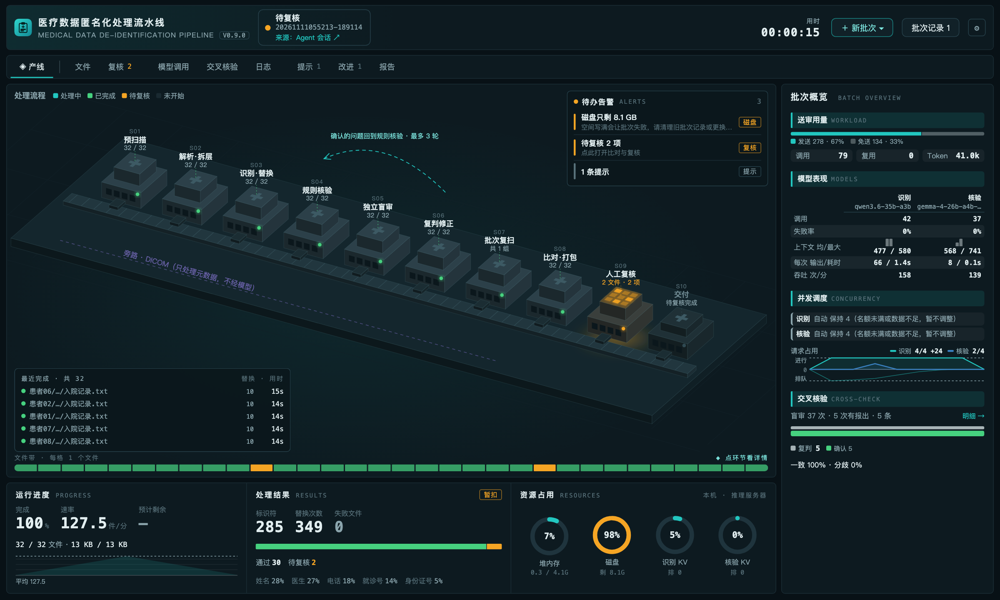
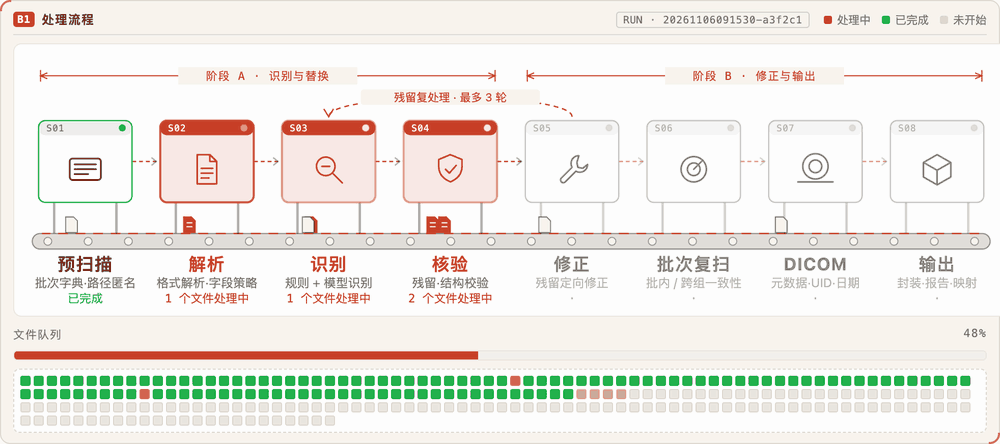

# dsh-medical-anonymizer

[简体中文](README.md) | **English**

A [DeepSeek Harness](https://github.com/deepseek-ai/deepseek-harness) (Cordis)
plugin for batch de-identification of medical records and tables. It finds
direct identifiers, replaces them with stable pseudonyms, keeps the file
structure intact, and writes an audit report plus a re-identification vault.

> This is a data-processing tool, not a compliance certification. Review the
> applicable law and your institution's policy before publishing any output.



<p align="center"></p>

<sub>Screenshots use synthetic data; no real patient information.</sub>

## Why this one

- **Structure is preserved by construction.** The model only annotates text;
  the plugin locates exact spans and replaces only those spans. Line counts,
  CSV columns, JSON keys, and non-text Excel cells do not move.
- **Deterministic first, model optional.** Chinese ID checksums, phone/email
  patterns, labeled fields, and column/key policies run without a model. A
  model pass adds recall on free text and re-checks the result.
- **Bounded repair loop.** Findings from the check round go back to discovery,
  with a round limit. Unresolved items are marked for manual review instead of
  being silently accepted.
- **Local-first.** No telemetry. The plugin only contacts the OpenAI-compatible
  endpoint you configure; point it at a local runtime to keep data on the box.
- **Auditable output.** Per-file entity counts, structure checks, residual
  issues, a manual-review list, and a vault that is the only place holding
  original values. The report does not print identifier values.

## Features

| Area | What it does |
| --- | --- |
| Formats | `.txt`, `.md`, `.csv`, `.json`, `.xlsx`; `.zip` archives (nested too, see [Zip archives](#zip-archives)); DICOM images (metadata only, see [DICOM images](#dicom-images)) |
| File and folder names | names, Chinese IDs, phone numbers, `patient_<id>`, `zyh_<admission no.>`, `mzh_<visit no.>` in paths get the same pseudonyms as the content, see [File and folder names](#file-and-folder-names) |
| Direct identifiers | name, doctor/staff name, Chinese ID, phone, email, address, medical-record number, admission number, visit number, social-security number, bank card, hospital name |
| Column/key policy | headers such as `姓名`, `身份证号`, `电话`, `住址`, and keys such as `PTT_NM`, `ID_CRD_NO`, `CTCT_TEL_NO`, `CURR_ADDR*`, `*_DCT_NM`, `MDC_ORG_NM`, `PID`, `INHOS_NO` are pseudonymized wholesale; record keys such as `PRM_KEY`/`RCD_NO` are masked as record identifiers |
| Pseudonyms | stable per value and type, e.g. `化名-9F3A2C`, `证件-1F0B67`; the same value gets the same token across files and batches sharing an output root |
| Configurable rules | per identifier type: stable pseudonym (default), partial mask, type label, or keep; postal codes always processed (first 3 digits or label); optional quasi-identifiers (date, age, sex): shift, generalize, or label — see [Anonymization rules](#anonymization-rules) |
| Verification | blind model review (no detection results shown; optional separate verification model), rule re-scan, original-value absence, structure diff; verifier findings are re-judged by the detection model, disagreements go to manual review |
| Runs | writes an anonymized copy directly, sources are read-only; model calls are not capped; files are processed concurrently; large batches are chunked automatically; cancellable; a batch's new mappings can be undone |
| Report | Markdown + JSON, per file and batch, with a manual-review list |

## Install

Requires DSH `>= 0.2.1` (tested on `0.2.1-rc.5`) and Node.js `>= 20`.

```bash
dsh plugin --profile <profile> add github:wld007/dsh-medical-anonymizer
# or, after an npm release:
dsh plugin --profile <profile> add dsh-medical-anonymizer
```

Restart DSH after installing: the plugin layer is composed at startup.

The settings page appears at **Settings → Medical Data Anonymization**. The
`/anonymize` command and the agent tools are available as soon as the host half
is active.

## Model setup

The plugin never calls a built-in cloud model. It only uses the
OpenAI-compatible endpoint you configure.

| Runtime | Base URL | Notes |
| --- | --- | --- |
| Ollama | `http://127.0.0.1:11434/v1` | Recommended for local use |
| LM Studio | `http://127.0.0.1:1234/v1` | Enable the local server |
| vLLM / llama.cpp | your `/v1` endpoint | Any OpenAI-compatible chat server |

Leave the model name empty to run the deterministic rule layer only. With a
model configured, the plugin sends each batch of text to that endpoint for
discovery and verification; if the endpoint is remote, the text leaves this
machine. Use a local or institution-controlled endpoint for patient data.

Reasoning models (Qwen3 and similar) can spend the whole token budget on hidden
reasoning. **Disable thinking** is on by default; leave it checked, or pass
`--no-think` to `/anonymize`. Uncheck it (or pass `--think`) only if your model
needs reasoning. Servers that reject the optional request fields are retried
once without them.

## Usage

### Settings → Medical Data Anonymization (configuration)

Configuration only, with a collapsible **How it works** guide at the top:

- **Local model**: endpoint, model, API key, disable thinking, model call timeout, temperature, **Test
  connection** (flags a model name the endpoint does not serve).
- **Batch defaults**: output root, max rounds, files per chunk, files processed at the same time, DICOM cap per batch.
- **Vault encryption**: set, change, or clear `vaultPassphrase` (entered twice, never shown again). After changing or clearing it, vaults encrypted with the old passphrase can no longer be read.
- **Anonymization rules**: treatment per identifier type, the quasi-identifier
  switch, and treatment per quasi-identifier type, each with a live example.
- **Interface**: show or hide the **Medical Anonymization** entry in the left
  sidebar. When hidden, `/anonymize` and the agent tools still work.
- The save bar lists unsaved fields; **Save** writes them into the profile's own
  config layer, so they survive restarts and plugin updates. The API key is
  saved only when you type or clear it, is never shown again, and lives in the
  profile config file (mode 600). Saving is refused while a batch is running,
  because it re-applies the plugin.

### Left sidebar → Medical Anonymization (pipeline dashboard)

One screen for the whole batch: input on the left, the pipeline in the middle,
monitoring and settings on the right. The interface is in Chinese or English
following the Harness locale.

| Area | Content |
| --- | --- |
| A1 Input | Choose folders or files / `.zip` (native macOS dialog; ⌘-click several in one folder to process them as one batch, each delivered separately); optional output root |
| A2 Batches | History with status and origin (page / `/anonymize` / agent session, linked back); delete a record, optionally with its deliverable |
| B1 Pipeline | 10 stations: prescan → parse & unwrap → detect & replace → rule checks → blind review → re-judge & fix → batch rescan → compare & pack → manual review → deliver, DICOM as a bypass; re-judge loops back to the rule checks, up to N rounds; blind review shows the verification model, manual review shows the held state; the file queue below colors each file |
| B2 / B3 | Identifiers replaced by type; verification outcome (clean / review / failed) and the deliverable path |
| Bottom tabs | Files (click a row to compare), log, model calls (duration strip + per-call metadata), notices, report (rendered Markdown, full screen) |
| Compare | Full-screen, file by file: file list on the left, original and result side by side per field (originals red, pseudonyms green, suspects orange); review items are decided right there (replace / not an identifier / keep) |
| C1 Monitor | Progress, throughput curve, files left and ETA, identifiers, model calls, review items, tokens, memory |
| C2 Settings | Rounds, concurrency, chunk size, timeout, temperature, thinking, quasi-identifier switch; locked while running; everything else under All settings |
| C3 Improvements | One-click setting suggestions after each batch; a value-free plugin-improvement draft for what settings cannot fix |

Click the title to open the processing reference: scope, current identifier
treatments, pipeline diagram with each stage's method, principles, output
layout, and outcomes.

### `/anonymize` command

```text
/anonymize /path/to/records --model qwen2.5:14b --endpoint http://127.0.0.1:11434/v1
```

Anonymized files are written directly (source files are read-only and never
modified).

The input may also be a single file, e.g. `/anonymize /path/to/note.txt` or
`/anonymize /path/to/records.zip`: only that file is processed, the result is
`note.txt` directly in the output root, and the default output root is a
`_medical-anonymizer` folder next to the file.

Options: `--rounds N`, `--output DIR`, `--no-think`, `--think`.

### Agent tools

| Tool | Purpose |
| --- | --- |
| `anonymize_start` | Start a batch and return its `runId` |
| `anonymize_cancel` | Cancel the running batch; written files stay |
| `anonymize_status` | Progress, entity counts, unresolved issues |
| `anonymize_report` | Read the Markdown report |
| `anonymize_runs` | List recent batches |
| `anonymize_undo_mappings` | Remove the mappings a batch added to the vault (output files are not deleted) |

`anonymize_start` parameters: `inputDir` (a directory, a single file, or a `.zip`), `outputRoot`, `maxRounds`.

The agent tools cannot choose the model endpoint, model, API key, or thinking
mode: those always come from the user's saved settings, so an agent cannot
redirect patient text to another service. The tool description names the
plugin and this data boundary, which helps the agent pick it over similarly
named tools. Only the human-typed `/anonymize` command accepts `--endpoint` and
`--model` overrides.

## How it works

1. **Rule pre-scan.** Chinese ID (checksum-validated), mobile/landline, email,
   bank card (Luhn), MRN/admission/visit numbers, labeled names/addresses/
   hospitals/doctors, and EMR template fields whose label and value are split
   by markup (`F=[引用值:姓名]…[<isele 0>value<isele 1>]`).
2. **Column and key policy.** Dedicated fields are pseudonymized as a whole,
   including common hospital-export keys such as `PTT_NM`, `ID_CRD_NO`,
   `CTCT_TEL_NO`, `*_ADDR*`, `*_DCT_NM`, `*_STFF_NM`, `MDC_ORG_NM`, `PID`,
   `INHOS_NO`, `*_DCT_CD`/`*_NUS_CD` (staff codes) and `*_SGNT` (signatures);
   from regional health-platform exports also `SLF_NM` (self name), `*_PSN_NM`
   (sample collector, reviewer, …), `WRK_UNT_NM` (employer), linkage keys
   `USER_ID`, `VST_UNQ_ID`, `OTPT_EMG_NO`, `RGST_NO`, and institution codes
   `*_ORG_CD`. Item/value records such as `{"ITM_NM": "姓名", "ITM_VLU": "…"}`
   are judged by the item name. Columns that describe an identifier (`ID_CRD_CGY_CD` card type, `*_TP_*`,
   `*_FLG`, …) are not identifier columns.
3. **Optional model discovery.** Batches of text are sent to the configured
   endpoint, with field names. Identical texts are sent once; pure numbers/dates
   and already-anonymized values are not sent. The model returns
   `{segment, type, text}`; the plugin locates the exact text in the source.
   Model coordinates are never trusted.
   **Format check:** a result that cannot be of its type is not replaced and is
   listed as a hint — e.g. `01` in an ID-card column, or a department name such
   as `内一科(肾脏病科)(11病区)` returned as a hospital.
   **Document-wide expansion:** a found value is also replaced where it recurs,
   but never inside a longer run of letters/digits (`01` does not hit
   `2001017`), and codes shorter than 6 characters are replaced only where they
   were detected.
   Categories and common nouns such as `区属医院`, `综合医院`, `中医院` or a bare
   `医院` are not hospital names.
   **Across files:** before processing, a model-free pass over all files (column
   policy + rules) builds a batch dictionary, so a name or ID found in one file
   is replaced in every other file. After all files are done, a batch re-check
   catches values that only a later file (or the model) revealed; the report
   lists it as `批次复扫`. Administrative region names (province, city, county)
   do not spread across files.
   Batches larger than `maxFiles` (default 200) are split into chunks
   automatically: each chunk is re-checked and released from memory when done,
   and a final cross-chunk re-check runs over the earlier chunks' output.
   `concurrency` (default 4) files are processed at a time.
   A bare JSON `name` key is treated as a person's name only when its object
   also carries personal attributes such as age, sex, birth date, ID number,
   phone, or address (diagnoses `{icd10, name}`, lab items, and drugs are not
   affected); a full institution name in a name column is treated as a hospital.
4. **Pseudonymization.** `HMAC-SHA256(salt, type + value)` produces a stable
   token per value and type. Only the matched span changes.
5. **Verification.** Model re-check, rule re-scan, original-value absence (with
   the masked value and field names), embedded-pseudonym check (a pseudonym glued
   to letters/digits means a longer value was partly replaced), numbers/dates in
   structured data replaced only as a whole, and a structure diff (line count,
   CSV shape/header, JSON key/type shape, Excel non-text cells).
6. **Bounded repair.** Errors go back to discovery for another round, up to
   `maxRounds`. If no progress is made, the file is marked `review` and listed
   for manual review.

## Anonymization rules

Defaults reproduce the behaviour of earlier versions: every identifier becomes a
stable pseudonym, and quasi-identifiers are left untouched.

| Identifier strategy | Example (`张三`, `13800138000`) | Reversible |
| --- | --- | --- |
| `pseudonym` (default) | `化名-9F3A2C`, `电话-7A8ED8` | yes, through the vault |
| `mask` | `张*`, `138****8000` | no; part of the value remains |
| `redact` | `[姓名]`, `[电话]` | no |
| `keep` | unchanged | — |

Masks: names keep the first character; ID keeps the first 3 and last 4
characters; phone the first 3 and last 4 digits; bank card and record numbers
the last 4; email the first letter and domain; address the province/city/district
prefix; hospital the first 2 characters and the suffix.

Date, age, and sex are processed only when **quasiIdentifiers** is on. Postal
codes are identifiers (one of the HIPAA 18) and are always processed; they cannot
be kept (a stored `keep` is treated as `prefix3`). All of these are handled
deterministically after identifiers, without the model:

| Type | Strategies (default first when enabled) | Example |
| --- | --- | --- |
| Date | `shift`, `month`, `year`, `redact`, `keep` | `2024-03-01` → `2024-04-07` / `2024-03` / `2024` |
| Age | `band10`, `band5`, `redact`, `keep` | `45岁` → `40-49岁` / `45-49岁`; 90 and over → `90岁及以上` |
| Sex | `keep`, `redact` | `男` → `[性别]` |
| Postal code (always) | `prefix3`, `redact` | `100020` → `100***` |

- Detection covers prose (`2024-03-01`, `2024年3月1日`, `45岁`, `年龄：45`,
  `性别：男`, `邮编：100020`) and fields named like `BTH_DT`, `*_DT`, `出生日期`,
  `AGE`, `GDR_NM`, `SEX`, `ZIP`, `邮编`; compact `YYYYMMDD` only in date fields.
- Date shifting uses one offset (±1–365 days) per output root, derived from the
  vault salt, so intervals between dates and across batches are preserved. The
  offset never appears in reports. Do not re-run shifting on its own output.
- Only text values change: Excel numeric/date cells and JSON numbers are left
  as-is, and the report says so.

### Excluding false positives

When the report shows a false positive, add it under Settings → Anonymization
rules → Exclude false positives (one item per line) and run again:

- `allowValues`: never treated as identifiers, e.g. `01`, `居民身份证`, a
  department name. Mappings an earlier run stored for them are removed from the
  vault on the next run.
- `skipFields`: column or JSON key names (case-insensitive) that are not
  scanned, replaced, or sent to the model, e.g. `ADMN_BED_NO`.

## DICOM images

Metadata de-identification for CT and other DICOM images. Pixel data is kept
byte for byte: never decoded, modified, or sent to a model.

- Detection: `.dcm`/`.dicom`/`.dic`/`.ima`, extensionless, or numeric-extension
  files (typical PACS exports), confirmed by the `DICM` marker.
- Rules: DICOM PS3.15 Annex E Basic Application Level Confidentiality Profile
  with the Retain Longitudinal (modified dates) and Retain Patient
  Characteristics options:
  - patient and physician names emptied or removed; every PN attribute removed;
  - birth date emptied; addresses, phones, other IDs, accession number, study ID,
    institution, department, device serial, station name, comments and request
    details removed;
  - private (odd-group) attributes, curves, overlay comments, icon images and
    digital signatures removed;
  - **PatientID** becomes a cuid-style code, consistent per patient within one
    batch. The key lives only in memory for that run and is never stored, so the
    code cannot be traced back (and is not written to the vault). Process all
    images of one patient in the same batch;
  - instance UIDs become `2.25.<decimal>`, derived from the vault salt, so
    cross-file references and re-runs stay consistent; class/syntax UIDs are kept;
  - dates shift by the same offset as text; times kept; age kept (≥90 → `090Y`);
    sex, size and weight kept;
  - study/series description and protocol name kept but rule-scanned; any hit
    (phone, ID number, …) removes the whole attribute.
- With quasi-identifier handling on, DICOM follows the same date/age/sex policy
  (age bands are written as their lower bound, e.g. `040Y`).
- Writes `PatientIdentityRemoved=YES`, the de-identification method and code
  sequence, and `LongitudinalTemporalInformationModified`.
- Checks: header re-parse; leftover names/private tags/original UIDs; removed
  identity values (names, IDs, birth date, institution) reappearing in kept
  attributes are flagged for review; pixel data SHA-256 compared with the source.
- Implicit/explicit VR little endian and all encapsulated syntaxes are
  supported. Explicit VR big endian, deflated data sets and broken/truncated
  files fail. `DICOMDIR` is not copied; regenerate it on the output.
- `maxDicomFiles` (default 50000) caps DICOM files per batch, independently of
  the text-file chunk size `maxFiles`. The report lists only DICOM files with issues and summarizes the
  rest per directory.
- Not handled: text burned into pixels, face reconstruction, NIfTI, whole-slide
  pathology.

## Output

```text
<outputRoot>/
  <input folder name>/       # result: anonymized data only, same layout (identifiers in names replaced); take it as is
  <input folder name> (2)/   # the same input run again: numbered, earlier results are never overwritten
  note.txt                   # result of a single-file input
  _records/
    vault.json               # original <-> pseudonym, mode 0600
    index.json               # recent batches
    runs/<runId>/
      report.md
      report.json
      path-map.json          # original <-> new path, only when a path was renamed; mode 0600, as sensitive as the vault
      advice.json            # improvement suggestions (allow-list candidates hold original values; mode 0600), shown in the Improvements panel
      calls.json             # model-call log: time, file, stage, duration, tokens, outcome (no prompts or replies)
      model-cache.jsonl      # model replies of an unfinished batch, replayed by Resume; quotes originals, mode 0600, deleted once a batch finishes
      resume.json            # original input path of an unfinished batch, for Resume (mode 0600)
      review-items.json      # review items with original context (holds originals, mode 0600)
      compare/               # per-file comparison: changed segments, original and result (holds originals, mode 0600)
      review/                # anonymized copies of files that need review, taken out of zips too (x.zip becomes x (zip)/)
      output/                # staging while running; moved to the output root when the batch finishes. Partial results of a cancelled/failed batch stay here
```

A result appears in the output root only once its batch has finished
(including Needs review), so everything there is complete. `vault.json`,
`index.json`, and `runs/` left in the output root by 0.7 and earlier move into
`_records` on the next run; the vault keeps working and pseudonyms stay the same.

`vault.json` is the re-identification key. Keep it separate from the output and
protect it accordingly. The report deliberately contains no original values.
Set `vaultPassphrase` on the settings page (Batches & UI → Vault encryption) or in the plugin config to encrypt the vault with
AES-256-GCM; without it the vault is plaintext JSON with mode 0600.

Without an explicit or configured `outputRoot`, output goes to a
`_medical-anonymizer` folder (visible in Finder) **beside** the input directory, so sibling
batches (for example one folder per patient) share one vault and keep
consistent pseudonyms. When a parent directory is anonymized later, folders
named `_medical-anonymizer` or holding `_records/vault.json` are skipped, so the
vault is never read in as records. 0.7 and earlier used the hidden
`.medical-anonymizer`; if no `_medical-anonymizer` exists yet, it is renamed and reused. The output root may not equal the input directory. If
you place it inside the input directory, it is excluded from scanning, so the
vault and earlier outputs are never read back in as records.

Files with unsupported extensions and archives that cannot be extracted are
listed in the report's **注意** section; a batch with an unextractable archive
is marked `review`.

### Source protection

The plugin never modifies its input:

- Before every write, symlinks are resolved and the target must be inside this
  batch's output directory and outside the input directory; otherwise the
  write is refused. A batch whose output root equals or contains the input is
  refused at start.
- The size and modification time of every source file (including the archives
  themselves) are recorded before the run and re-checked afterwards; the result
  appears in the report under "源文件检查". If another program changes a source
  file during the run, the batch is marked `review`.
- The tests assert, for every input type, that the input directory is
  byte-for-byte identical before and after a run.

### Undo mappings

Every new mapping in the vault records the batch that first created it. If a
rule misfired, call `anonymize_undo_mappings` (parameter `runId`) to remove the
mappings that batch added; after fixing the rules, a re-run creates them again.
Output files are not deleted.

## Zip archives

- `.zip` files (including ZIP64 and GBK file names produced on Windows) are
  extracted to a system temporary directory, processed, and repacked into the
  output directory with the original internal layout (UTF-8 file names). The
  temporary directory is deleted when the batch ends, including on cancel or
  failure. The original archive is read-only.
- Nested archives are expanded up to 3 levels deep. Only stored and Deflate
  entries are supported; encrypted and multi-volume archives are not processed.
- Safety limits: entries with absolute paths, `..`, or otherwise escaping the
  extraction root are rejected. By default at most 20000 entries, 2 GiB
  extracted in total, 500 MiB per file, and a 1000:1 compression ratio (for
  entries over 1 MiB); anything beyond is rejected as a suspected zip bomb.
  Every entry's CRC is verified.
- For an archive that cannot be extracted, the report gives only the reason
  category, never the names of files inside it (they may contain names).

## File and folder names

Identifiers in output paths are replaced before writing, using the same vault
as the content, so the same person gets the same pseudonym in the file name and
in the text:

- `64_张三_<ID number>.zip` → `64_化名-XXXXXX_证件-XXXXXX.zip`
- `patient_573453/stays/zyh_1008593/` → `patient_病历-XXXXXX/stays/zyh_住院-XXXXXX/`
- `visits/mzh_3444733_check.json` → `visits/mzh_就诊-XXXXXX_check.json`

Category folders (inpatient, outpatient, lab, …), year/month folders, table
names (`p_doc_gehr_*_rcd`), campus codes (`h5650`), and sequence numbers are
kept. The mapping from original to new paths is written to
`_records/runs/<runId>/path-map.json` (mode 0600); reports and the batch list show only
the replaced paths.

## Privacy and security

- No telemetry, analytics, or hidden network calls. The only outbound request is
  to the configured chat endpoint (plus `/models` when you press Test).
- The model sees the text it is asked to check. For patient data, use a local
  runtime or an endpoint inside your trust boundary. Plain HTTP on a shared
  network is not a safe transport.
- The report omits identifier values but includes the input/output paths; treat
  both the report and the vault as PHI.
- The plugin never rewrites input files (see [Source protection](#source-protection));
  output goes to the root you choose.
- Common identifiers in file and directory names are replaced. A name glued to
  other text without a separator (e.g. `张三病历.md`) is not detected; check
  file names before publishing.
- Not a compliance certification. Unless quasi-identifier processing is on,
  dates, age, sex, institution, and rare diagnosis combinations can still
  re-identify; the report states which quasi-identifiers were handled.
- `mask` keeps part of the original and is irreversible; `keep` leaves an
  identifier in the output. Both are listed in the report's warnings.

## Configuration

Defaults live in `cordis.patch.yml` and can be overridden in the profile patch
layer:

```yaml
- id: medical-anonymizer
  config:
    baseURL: http://127.0.0.1:11434/v1
    model: qwen2.5:14b
    outputRoot: ''
    maxRounds: 3
    maxFiles: 200
    concurrency: 4
    maxDicomFiles: 50000
    timeoutMs: 120000
    temperature: 0
    disableThinking: true
    vaultPassphrase: ''
    identifierPolicy: { name: pseudonym, phone: mask, hospital: keep }  # unlisted types: pseudonym
    quasiIdentifiers: false
    quasiPolicy: { date: shift, age: band10, sex: keep, postalCode: prefix3 }
    allowValues: ['01', '居民身份证']
    skipFields: [ADMN_BED_NO]
```

- `maxFiles` is the chunk size for automatic grouping (files beyond it are not
  dropped); `concurrency` is the number of files processed at a time. Model
  calls are not capped.
- Labeled 7–8 digit landline numbers without an area code (e.g. `电话：`)
  are phone numbers and always detected; hospital switchboard numbers are
  replaced too (exempt them with `allowValues`). An old `landline` setting no
  longer has an effect.
- `timeoutMs` is the per-call model timeout.
- `outputRoot` empty means `<parent of input>/_medical-anonymizer`.

## Supported formats and limits

- Input: `.txt`, `.md`, `.csv`, `.json`, `.xlsx`, `.zip`, and DICOM (metadata only).
- Direct identifiers and postal codes by default; quasi-identifier handling
  (date, age, sex) is opt-in. Department, institution code, and order numbers are
  never generalized. Record keys matching `PRM_KEY`/`RCD_NO` are treated as
  record identifiers; order numbers are not.
- Field hints cover common Chinese and English hospital schemas. Unusual field
  names need an extra pattern in `lib/formats.js` (`HEADER_HINTS`).
- No Word, PDF, or plain images; DICOM pixels are not processed. JSON output is pretty-printed; keys, arrays,
  and value types are unchanged.
- The model pass is optional and its quality depends on the model. The
  deterministic layer is the baseline.

## Development

```bash
npm test                      # field hints, rule policy, zip, paths, end-to-end pipeline, DICOM
node scripts/build.mjs 0.8.0  # build a versioned dist/ for a local profile
```

`npm test` uses a deterministic mock model; no network or real data is needed.
A local install is for development only. End users install from GitHub or npm.

## Troubleshooting

- **The model times out or returns empty content.** Enable disable-thinking,
  use an instruct (non-reasoning) model, or leave the model empty and rely on
  the rule layer. The run continues and records a model warning.
- **No identifiers are found in a structured file.** Check whether its field
  names are in `HEADER_HINTS`; add a pattern for your schema.
- **The settings page is missing.** Confirm the profile is on DSH `>= 0.2.1`,
  the bundle is enabled, and the page was reloaded after installation.
- **`vault.json` cannot be read.** It was encrypted with a `vaultPassphrase`;
  configure the same passphrase to read it.

## License

MIT. See [LICENSE](LICENSE). This package vendors SheetJS Community Edition
0.20.3 under Apache-2.0; see [NOTICE](NOTICE) and
[vendor/SheetJS-LICENSE.txt](vendor/SheetJS-LICENSE.txt).
