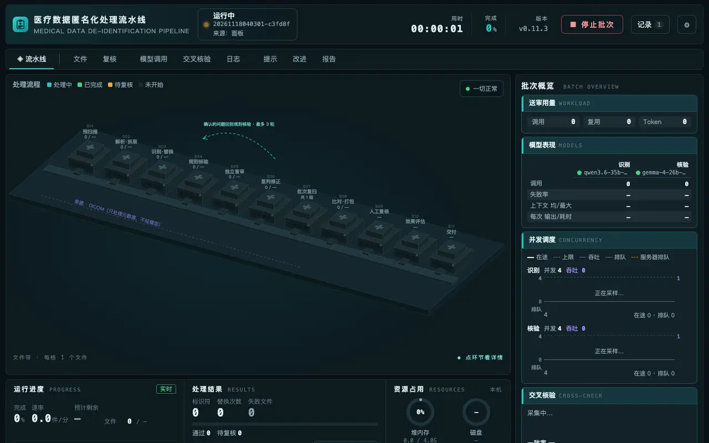
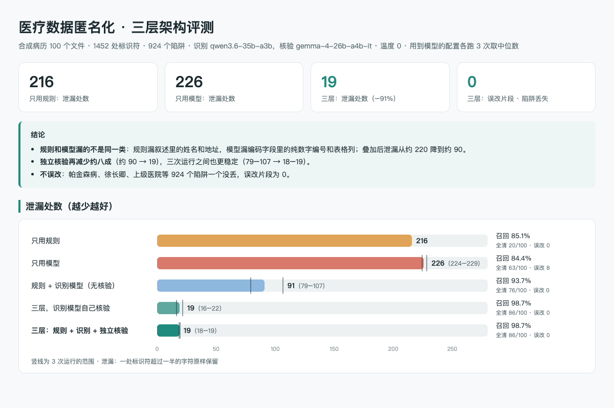

<div align="center">

# Medical Data De-identification Pipeline · dsh-medical-anonymizer

**Batch de-identification of clinical notes, tables and DICOM metadata: identifiers become stable pseudonyms, file structure stays intact, and the result is assessed for its degree of anonymization.**

[简体中文](https://github.com/wld007/dsh-medical-anonymizer/blob/main/README.md) · English

A DeepSeek Harness plugin · rules + two-model cross-checking · k-anonymity assessment with a Word report · records go only to your own model endpoints

[](https://www.npmjs.com/package/dsh-medical-anonymizer)




<sub>Recorded from a real run on synthetic records (`eval/bench/gen.mjs`, 150 fictional patients, 204 files) with two locally served models: the Pipeline, the assessment station, Review and Report. Re-record with `scripts/readme-demo.mjs`. The UI follows the Harness locale; shown in Chinese.</sub>

</div>

---

> This is a data-processing tool, not a compliance certification. Review the applicable law and your institution's
> policy before publishing any output.

## What it does

Hand the plugin a batch of records. It finds the direct identifiers, replaces them with stable pseudonyms, and delivers
data with exactly the same structure, ready for downstream use:

```
raw records → [De-identification] → output/ (pseudonymized) → event reconstruction, chart abstraction, HL7 FHIR, research…
```

- **Structure preserved**: the model only annotates text; the plugin locates and replaces exact spans itself. Line
  counts, CSV columns, JSON keys and non-text Excel cells do not move; encoded content in fields (base64, HTML, XML,
  nested JSON, gzip / LZMA, the CaseDocdata EMR document container) is unwrapped, checked and by default saved as the decoded text (or written back in its original format, as set); embedded images are replaced with a placeholder by default.
- **Stable pseudonyms**: one value gets one pseudonym in every file (e.g. `化名-9F3A2C`), so a patient can still be
  linked across files; the mapping lives only in the vault. Each identifier type can instead be masked, labelled or kept.
- **Three layers**: rules, a detection model and an independent verification model; what cannot be resolved goes to a
  human instead of being accepted silently (see [below](#three-layers-and-cross-checking)).
- **Effect assessment**: before delivery, K-anonymity and the degree of anonymization A on the result, an identifiability
  level, and a Word assessment report for an evaluator to sign (see [below](#effect-assessment)).
- **Local-first, auditable**: no telemetry, only the model endpoints you configure; reports never print original values.

| Area | What it does |
| --- | --- |
| Formats | `.txt` `.md` `.csv` `.json` `.xlsx`, `.zip` (nested too), DICOM (metadata only, no model) |
| Identifiers | names, doctors/staff, Chinese IDs, phone, email, address, record/admission/visit numbers, social-security and bank-card numbers, hospitals; the same in file and folder names |
| Quasi-identifiers | optional: dates shifted or generalized, age bands, sex kept or removed; postal codes always processed (first 3 digits or a type label) |

## Three layers and cross-checking

Rules are good at fixed formats, models at names and addresses in prose, and they miss different things. The plugin
stacks them, then has another model look for what is left:

```
                 ┌── rules: ID checksums, phone, email, labelled fields, column / key names ──┐
files ─ unwrap ──┤                                                                            ├─▶ exact spans → stable pseudonyms
                 └── detection model: names, addresses, institutions, staff in free text ─────┘
                                                    │
                     rule checks: rescan, originals gone, structure unchanged
                                                    │
                     independent blind review: the verifier sees only the replaced text and tries to re-identify people
                                                    │
               suspects ─▶ the detection model re-judges against the source: confirmed ones replaced,
                           false alarms kept, back to rule checks; at most 3 rounds (configurable 1–6)
                                                    │
               still disputed, images, undecodable content ─▶ manual review on the page; delivery held until done
```

- **Independent**: the blind review gets only the replaced text, not what the detection model found, so it cannot just
  agree. The verifier may use another endpoint and model; when empty, the detection model does it.
- **Rules as the floor**: fixed-format identifiers need no model; without a model only the rule layer runs.
- **Consistent across files**: after each chunk, every file is rescanned with all identifiers the batch has found.
- **Column profiles**: structured files are judged per column once; identifier columns are replaced whole, clinical
  vocabularies and codes are reviewed per column instead of value by value.

## Benchmark: rules vs. a single model vs. three layers

On a labelled synthetic corpus (18 fictional patients, 100 files, 1452 identifiers, 924 traps that must survive),
five configurations were compared. Detection qwen3.6-35b-a3b, verification gemma-4-26b-a4b-it, local, temperature 0;
configurations with a model ran 3 times, medians shown:



| Configuration | Leaks | Recall | Clean files | Over-redactions | Traps lost | Tokens |
|---|---:|---:|---:|---:|---:|---:|
| Rules only | 216 | 85.1% | 20 / 100 | 0 | 0 | 0 |
| Model only | 226 | 84.4% | 63 / 100 | 8 | 7 | 89k |
| Rules + detection model (no verification) | 91 | 93.7% | 76 / 100 | 0 | 0 | 61k |
| Three layers, detection model verifies itself | 19 | 98.7% | 86 / 100 | 0 | 0 | 139k |
| **Three layers: rules + detection + independent verification** | **19** | **98.7%** | **86 / 100** | **0** | **0** | 152k |

Findings:

- **Rules and the model miss different things**: rules miss names and addresses in prose and spaced-out signatures;
  the model misses bare record numbers in coded fields, outside hospitals and table columns, and re-replaces masked
  values such as “张*”. Each alone leaks about 220; together about 90.
- **Verification removes about four fifths of the rest** (about 90 → 19) and makes runs consistent (79–107 → 18–19).
  Independent and self-verification have the same median here; independent verification varies less.
- **No over-redaction**: eponymous diseases, herbs that read like names, “上级医院”, approval numbers — no trap lost.
- **Still missed**: mostly outside staff named in prose, the next thing to improve.

The corpus is generated from templates and tidier than real records; the numbers show what each layer contributes, not
the leak rate on real data. Full report: [docs/benchmark](docs/benchmark/README.md); corpus, scoring and how to rerun:
[eval/bench](eval/bench/README.md).

## Effect assessment

After each batch the **delivered data** (after anonymization) is assessed; the result shows at the **S10 assessment**
station, in the report, and in a Word report:

```
delivered data ── find quasi-identifier columns (sex, age, birth date, visit time, institution, region, occupation …)
               ── group by their combination, counting people when there is a person column ─▶ K = smallest group
                                                       │
                       A = K × S × E  ≥ 1 passes ◀─────┘    S: scenario coefficient   E: environment (1 = typical)
                         │
                         ├─ identifiability level 1–4 (3 = direct identifiers removed, re-identification risk below threshold)
                         ├─ with a diagnosis column: l-diversity and t-closeness
                         └─ below requirement: shown red, with the classes below the target and the column with the largest effect
```

| Scenario | S | K needed (E = 1) |
| --- | ---: | ---: |
| Within one business unit | 1/3 | 3 |
| Across business units | 1/4 | 4 |
| Two external parties (default) | 1/5 | 5 |
| Several external parties | 1/6 | 6 |
| Public release | 1/20 | 20 |

- **Structured data only**: csv, every xlsx sheet, JSON record arrays, DICOM (per study). Files of one shape are pooled;
  free text cannot be grouped by column and is listed as needing other methods.
- **Word report** at `_records/runs/<batch>/匿名化效果评估报告.docx`: basics, processing strategy, cannot-identify,
  cannot-restore, adversarial test, overall evaluation, sign-off. The tool fills in what it can compute; the rest is for an
  evaluator independent of the processing. With open review items it is a draft, redone on the final data afterwards.
- **Too-fine ages and dates are the usual reason to fail**: on a 486-person lab table from `--patients 500`, K = 1
  with raw ages and K = 24, A = 4.8 with 10-year age bands.
- Scenario, environment coefficient, columns to leave out or add, and the **basis** named in the reports (national
  standards GB/T 37964—2019 and GB/T 42460—2023 by default; enter your provincial specification or internal policy) are
  under Settings → Anonymization rules; `anonymize_start` also takes `assessScene` and `assessEnvironment`.

> K covers only one side of "cannot identify". Treating data as anonymous also needs adversarial testing, proof that it
> cannot be restored (vault destroyed or isolated), and an independent evaluation.

## Install and configure

Requires DSH `>= 0.2.1` and Node.js `>= 20`. Install `dsh-medical-anonymizer` from the Harness plugin manager, or:

```bash
dsh plugin --profile <profile> add github:wld007/dsh-medical-anonymizer
```

Then, under Settings → Medical Data Anonymization:

- **Detection model**: an OpenAI-compatible `/v1` endpoint, model name and optional API key; check with Test connection.
  With no model only the rule layer runs, and many names and addresses in free text will be missed.
- **Verification model** (recommended): another endpoint and model for the blind review. Each model has its own
  concurrency, adjusted to measured throughput by default.
- **Disable thinking** (on by default): requests carry `chat_template_kwargs: {enable_thinking: false}`, retried without
  it when a server rejects the field.
- **Anonymization rules**: treatment per identifier type, quasi-identifiers, false-positive exclusions, unreadable
  content, effect assessment.

Used in development and testing: `qwen3.6-35b-a3b` (detection) and `gemma-4-26b-a4b-it` (verification) served by vLLM.
Records go only to the endpoints configured here; use a local or institution-internal service for patient data.

## Usage

- **Left sidebar → Medical Anonymization**: opens the pipeline page; "+ New batch" takes folders, files or a `.zip`.
  Tabs: Pipeline, Files, Review, Model calls, Cross-check, Log, Notices, Improvements, Report.
  - **Review**: original and result side by side (originals red, pseudonyms green, suspects orange); decide replace /
    not an identifier / keep, revert a false positive with a click, or select missed text to replace it. Embedded images
    show as thumbnails; a vision model can sort them (signature, seal, chart …) for bulk decisions.
- **Chat**: `/anonymize <input dir or file> [--output DIR] [--rounds N] [--model M --endpoint URL] [--no-think]`
- **Agent tools**: `anonymize_start`, `anonymize_status`, `anonymize_report`, `anonymize_runs`, `anonymize_cancel`,
  `anonymize_undo_mappings`. Agents cannot choose the endpoint, model or API key; the saved settings always apply.

## Pipeline and checks

| Station | What it does | Output / check |
|---|---|---|
| S01 Prescan | list files, unpack archives, replace identifiers in paths | batch dictionary; anonymized output paths |
| S02 Parse & unwrap | parse formats, decode nested content, split long fields; profile columns | content that cannot be unwrapped goes to review, never counted as passed |
| S03 Detect & replace | rules + detection model; exact spans replaced with pseudonyms | replaced content |
| S04 Rule checks | rescan, originals removed, structure check | fails on changed structure or leftover originals |
| S05 Blind review | verifier sees only replaced text and tries to re-identify people | suspects |
| S06 Re-judge & fix | detection model re-judges each suspect; back to S04, at most 3 rounds | disputes go to review |
| S07 Batch rescan | rescan every file with all identifiers found | consistent across files |
| S08 Compare & pack | segment-by-segment comparison, prepare the deliverable | comparison · report |
| S09 Manual review | disputes and unreadable content | delivery held until done |
| S10 Assessment | K, A = K × S × E, identifiability level; Word report | red when A < 1 |
| S11 Deliver | into `output/` once review is complete; sources checked unchanged | deliverable |
| Bypass DICOM | no model: names, IDs and private tags removed, UIDs regenerated, dates shifted, pixels untouched | de-identified images |

## Output

```text
<output root>/                  # default: _medical-anonymizer next to the input
  output/                       # deliverables; downstream tools read only this
    <input name>/               # same structure as the input, identifiers in names replaced
  _records/                     # records: never hand these on
    vault.sqlite                # vault: original ↔ pseudonym (with a passphrase each original is encrypted); keep it safe
    records.sqlite              # batches, review decisions, comparison, model calls, resume data
    runs/<batch>/report.md      # report (report.json is an export too)
    runs/<batch>/匿名化效果评估报告.docx   # formal assessment report, never in output/
    runs/<batch>/staging/       # held while running or under review
```

Sources are read-only and never modified. With open review items the deliverable waits in `staging/` and moves to
`output/` once all are decided.

## Scale

- **Chunks**: large inputs are split into chunks of 200 files (configurable) sharing the vault and batch dictionary;
  nothing is dropped. Up to 50,000 DICOM files per batch.
- **Concurrency**: detection and verification are limited separately and follow measured throughput and the inference
  server's queue; new files pause when memory is tight.
- **Resume**: each finished file is recorded; a cancelled, failed or interrupted batch can be continued, taking over
  finished files whose source is unchanged and reusing model replies; it keeps its batch id, and time, model calls
  and tokens keep adding up.

## Privacy and security

- The only outbound requests go to the model endpoints you configure. "Read images with the model" is on by default:
  images under review (mostly signatures and seals) are sent there too; turn it off under Anonymization rules.
- Reports hold no original values but do hold paths; treat reports, the records store and the vault as protected health
  information, and keep the vault apart from the deliverable.
- Dates, ages and sex are not processed by default and can still re-identify people in combination (the assessment
  shows it); `mask` and `keep` leave part or all of a value in the output.
- Names glued to other text without a separator in file names (e.g. `张三病历.md`) are not detected; check file names
  before publishing.

More: [Guide](docs/guide.en.md) (settings, how it works, rules, DICOM, output layout, configuration, troubleshooting) ·
[Changelog](CHANGELOG.md)

## Development

```sh
npm test                                     # tests (deterministic mock model; no network or real data)
node scripts/build.mjs 0.11.3-dev.1          # build dist/<version>, then install it from a profile
REACT_UMD_DIR=<node_modules with react/umd> node scripts/preview-page.mjs <output root>   # preview the page outside DSH

# benchmark (see eval/bench/README.md); --patients scales the corpus
node eval/bench/gen.mjs /tmp/anon-bench [--patients 500]

# re-record the README animation (synthetic records + models from the profile) and the benchmark chart
REACT_UMD_DIR=… node scripts/readme-demo.mjs /tmp/anon-demo
python3 scripts/readme-demo.py /tmp/anon-demo assets/demo.webp
node scripts/readme-chart.mjs assets/benchmark.png
```

## License

MIT, see [LICENSE](LICENSE). Bundles SheetJS Community Edition 0.20.3 (Apache-2.0), see [NOTICE](NOTICE).
