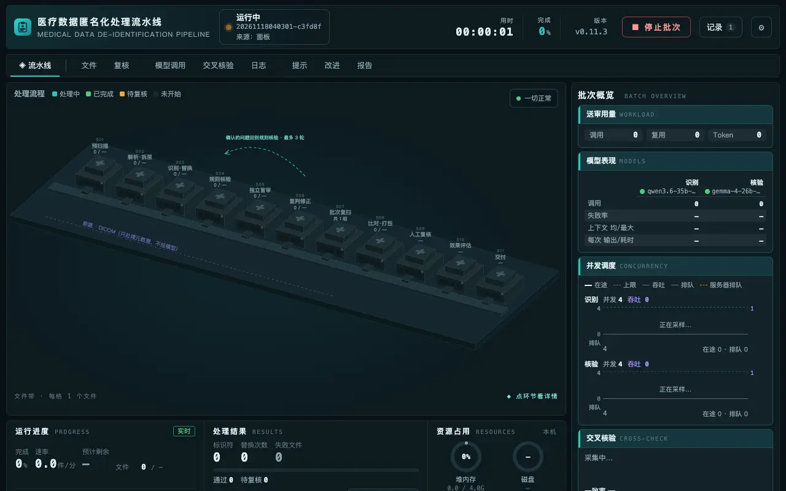
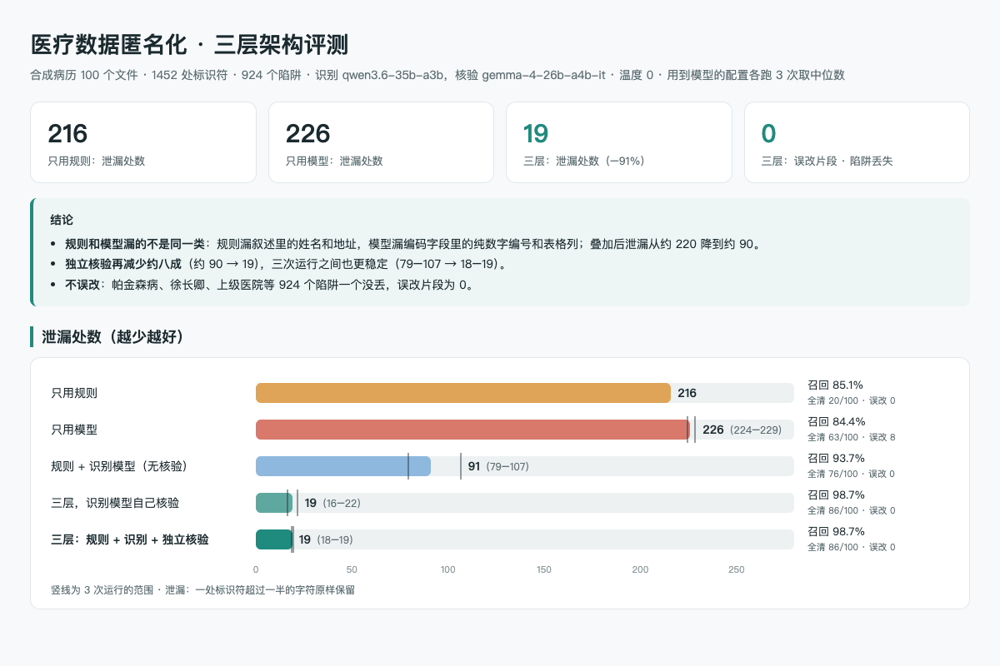

<div align="center">

# 医疗数据匿名化流水线 · dsh-medical-anonymizer

**批量匿名化病历文本、表格和 DICOM 元数据：标识符换成稳定假名，文件结构不变，最后算出匿名化程度。**

简体中文 · [English](https://github.com/wld007/dsh-medical-anonymizer/blob/main/README.en.md)

DeepSeek Harness 插件 · 规则 + 双模型交叉核验 · K 匿名效果评估与 Word 报告 · 病历只发往你自己的模型端点

[](https://www.npmjs.com/package/dsh-medical-anonymizer)




<sub>动画用合成病历（`eval/bench/gen.mjs`，150 位虚构病人、204 个文件）和本机部署的两个模型真实运行录制：依次看流水线、效果评估、复核、报告。用 `scripts/readme-demo.mjs` 可重录。</sub>

</div>

---

> 这是数据处理工具，不是合规认证。发布任何输出之前，请对照适用法律和本机构的政策进行审查。

## 它做什么

把一批病历交给插件，它找出里面的直接标识符，换成稳定假名，交付一份结构完全不变、可以直接给下游用的数据：

```
原始病历 → 【医疗数据匿名化】 → output/（假名化数据） → 病历事件还原、病历文书提取、HL7 标准化、科研统计……
```

- **结构不变**：模型只标注文本，插件自己在原文里定位并替换精确片段。行数、CSV 列、JSON 键、Excel 非文本单元格都不动；字段里的 base64、HTML、XML、嵌套 JSON、gzip / LZMA 压缩、电子病历文档容器（CaseDocdata）逐层拆开检查，改完按原格式写回。
- **稳定假名**：同一个值在所有文件里得到同一个假名（如 `化名-9F3A2C`），病人跨文件仍能关联；对照关系只存在映射库里。每类标识符也可以改为部分遮盖、类型标签或保留。
- **三层识别**：规则、识别模型、独立核验模型叠加，解决不了的转人工，不静默放过（见[下文](#三层识别与交叉核验)）。
- **效果评估**：交付前对结果数据算 K 匿名值和匿名化程度 A，评定标识度，生成 Word 版《匿名化效果评估报告》待评价人签署（见[下文](#匿名化效果评估)）。
- **本地优先、可审计**：无遥测，只访问你配置的模型端点；报告不打印原值，原值只在映射库里。

| 方面 | 说明 |
| --- | --- |
| 格式 | `.txt` `.md` `.csv` `.json` `.xlsx`、`.zip`（含嵌套）、DICOM（只处理元数据，不经模型） |
| 标识符 | 姓名、医生/职工、身份证、电话、邮箱、地址、病历号/住院号/就诊号、社保号、银行卡、医院；文件名和目录名里的同样替换 |
| 准标识符 | 可选：日期整体平移或泛化、年龄分段、性别保留或删除；邮编始终处理（保留前 3 位或类型标签） |

## 三层识别与交叉核验

规则擅长格式固定的东西，模型擅长叙述里的人名地址，两者漏的不是同一类。插件把它们叠起来，再让另一个模型独立挑错：

```
                ┌── 规则：身份证校验位、电话、邮箱、带标签字段、列名／键名 ──┐
文件 ──拆层──────┤                                                          ├─→ 插件逐字定位，替换为稳定假名
                └── 识别模型：自由文本里的姓名、地址、机构、医护 ────────────┘
                                                    │
                     规则核验：复扫、原值是否清除、结构是否一致
                                                    │
                     核验模型独立盲审：只看替换后的文本，尝试重新认出具体的人
                                                    │
               报出疑点 ─→ 识别模型对照原文复判：确认的补替换，误报保留，回到规则核验
                           至多 3 轮（可设 1–6）
                                                    │
               仍有分歧、图片和无法解码的内容 ─→ 人工复核（页面上逐条决定），未处理完前暂扣交付
```

- **独立**：盲审只给替换后的文本，不告诉它识别模型找到了什么，避免附和。核验模型可以用另一个端点和模型；留空时由识别模型兼做。
- **规则兜底**：格式固定的标识符不依赖模型，没配模型时插件也能只跑规则层。
- **跨文件一致**：一组文件处理完后，用全批已知的标识符回扫各文件，一个文件里认出的姓名在其他文件里也会被替换。
- **按列画像**：结构化文件按列判断一次性质，标识符列整列替换，临床词表和编码列不逐值送模型，只按列盲审。

## 评测：规则 vs 单模型 vs 三层

在带标注的合成病历（18 位虚构病人、100 个文件、1452 处标识符、924 个不该被替换的陷阱）上比较了五种做法，识别模型 qwen3.6-35b-a3b，核验模型 gemma-4-26b-a4b-it，本地部署、温度 0，用到模型的配置各跑 3 次取中位数：



| 配置 | 泄漏 | 召回 | 全清文件 | 误改片段 | 陷阱丢失 | tokens |
|---|---:|---:|---:|---:|---:|---:|
| 只用规则 | 216 | 85.1% | 20 / 100 | 0 | 0 | 0 |
| 只用模型 | 226 | 84.4% | 63 / 100 | 8 | 7 | 89k |
| 规则 + 识别模型（无核验） | 91 | 93.7% | 76 / 100 | 0 | 0 | 61k |
| 三层，识别模型自己核验 | 19 | 98.7% | 86 / 100 | 0 | 0 | 139k |
| **三层：规则 + 识别 + 独立核验** | **19** | **98.7%** | **86 / 100** | **0** | **0** | 152k |

结论：

- **规则和模型漏的不是同一类**：规则漏叙述里的姓名和地址、字间带空格的签名；模型漏编码字段里的纯数字病历号/门诊号、外院名称、表格列，还会把已遮盖的“张*”再替换一遍。各自单用泄漏都在 220 处左右，叠加后约 90 处。
- **核验层再减少约八成**（约 90 → 19），三次运行之间也稳定得多（79–107 → 18–19）。独立核验和识别模型自己核验在这份语料上中位数相同，独立核验的波动更小。
- **不误改**：帕金森病、徐长卿、上级医院、批准文号等陷阱一个没丢，误改片段为 0。
- **还漏的**主要是叙述里的外院医护姓名（“已与某医院的某某医生电话沟通”），是下一步要改的地方。

语料由模板生成，比真实病历规整，结果说明各层的作用和短板，不能直接当作真实数据上的泄漏率。完整报告（逐类难点、逐文件）：[docs/benchmark](docs/benchmark/README.md)；语料、计分和重跑方法见 [eval/bench](eval/bench/README.md)。

## 匿名化效果评估

每个批次结束后，插件对**交付数据**（匿名化之后）做一次效果评估，结果显示在流水线的 **S10 效果评估** 节点、报告的「匿名化效果评估」一节，并生成一份 Word 报告：

```
交付数据 ──按列识别准标识符（性别、年龄、出生日期、就诊时间、机构、地区、职业……）
         ──按组合分组，有人员列时按人数计 ──→ K = 最小组的人数
                                              │
              A = K × S × E  ≥ 1 达标 ←───────┘    S：场景系数   E：环境系数（中间值 1）
                │
                ├─ 标识度分级（1–4 级，3 级 = 消除了直接标识符、重标识风险低于阈值）
                ├─ 有诊断列时另算 L-多样性、T-接近性
                └─ 未达标：标红，写出小于目标 K 的组数和影响最大的列（不暂扣交付）
```

| 使用场景 | S | 达标所需 K（E = 1） |
| --- | ---: | ---: |
| 组织内部同一事业群 | 1/3 | 3 |
| 组织内部跨事业群 | 1/4 | 4 |
| 组织外部两方（默认） | 1/5 | 5 |
| 组织外部多方 | 1/6 | 6 |
| 对外公开 | 1/20 | 20 |

- **只算结构化数据**：csv、xlsx 各工作表、JSON 记录数组、DICOM（按检查）。同结构的多个文件合并成一个数据集；自由文本不能按列分组，报告注明需用其他方法评估。
- **Word 报告** 在 `_records/runs/<批次>/匿名化效果评估报告.docx`：基本信息、处理策略、无法识别评价、不能复原评价、对抗性测试、综合评价、签署栏。工具只填能算出来的部分，不能复原的核验、对抗性测试、综合结论和签字留给独立于处理人的评价/批准责任人。有待复核项时先出初稿，复核完成后按最终数据重算。
- **常见的未达标原因是年龄、日期太细**：用生成器 `--patients 500` 造的 486 人检验表，年龄原样时 K = 1；开启准标识符处理、年龄按 10 岁分段后 K = 24、A = 4.8。
- 使用场景、环境系数、不计入或额外计入准标识符的列、报告里写的**参考依据**（默认国家标准 GB/T 37964—2019、GB/T 42460—2023，可改为本省规范或本单位制度），在设置 →「匿名化规则」里配置；`anonymize_start` 也可以按批次传 `assessScene`、`assessEnvironment`。

> K 值只衡量“无法识别”的一个方面。正式认定为匿名数据，还需要对抗性测试、不能复原性核验（映射库销毁或隔离），并由独立的人出具评价意见。

## 安装与配置

要求 DSH `>= 0.2.1`、Node.js `>= 20`。在 DeepSeek Harness 的插件管理里安装 `dsh-medical-anonymizer`，或：

```bash
dsh plugin --profile <profile> add github:wld007/dsh-medical-anonymizer
```

然后在设置 →「医疗数据匿名化」里配置：

- **识别模型**：OpenAI 兼容的 `/v1` 端点、模型名、API Key（可选），用「测试连接」检查。留空时只运行规则层，自由文本里的姓名、地址会漏掉很多。
- **核验模型**（建议）：另一个端点＋模型，做独立盲审。两个模型各有并发额度，默认按实测吞吐自动调整。
- **关闭思考模式**（默认开）：请求带 `chat_template_kwargs: {enable_thinking: false}`，服务器不认时自动去掉重试。
- **匿名化规则**：每类标识符的处理方式、准标识符、排除误判、无法检查内容的处理、效果评估。

开发和测试中使用的组合：vLLM 部署的 `qwen3.6-35b-a3b`（识别）和 `gemma-4-26b-a4b-it`（核验）。病历内容只发往这里配置的端点，处理患者数据请使用本机或机构内网的服务。

## 用法

- **左侧栏「医疗数据匿名化」**：打开「医疗数据匿名化处理流水线」页面，点「＋ 新批次」选文件夹、文件或 `.zip`。页面有流水线、文件、复核、模型调用、交叉核验、日志、提示、改进、报告几页。
  - **复核**：逐份比对原文与结果（原值红、假名绿、可疑橙），直接决定替换、不是标识符或保留；误报一键还原，漏报选中即补替换。嵌入的图片显示缩略图，可让多模态模型识别类别（签名、印章、图表……）并按建议批量处理。
- **聊天框**：`/anonymize <输入目录或文件> [--output 目录] [--rounds N] [--model 名称 --endpoint URL] [--no-think]`
- **Agent 工具**：`anonymize_start`、`anonymize_status`、`anonymize_report`、`anonymize_runs`、`anonymize_cancel`、`anonymize_undo_mappings`。Agent 不能指定端点、模型或 API Key，始终用已保存的设置。

## 流水线与质检

| 环节 | 做什么 | 产出 / 质检 |
|---|---|---|
| S01 预扫描 | 列出文件、解压压缩包、替换路径中的标识符 | 批次字典；匿名化后的输出路径 |
| S02 解析·拆层 | 解析格式，逐层解码编码内容，超长字段切段；结构化文件按列画像 | 拆不开的内容转人工复核，不算通过 |
| S03 识别·替换 | 规则匹配 + 识别模型识别，插件逐字定位并替换为假名 | 替换后的内容 |
| S04 规则核验 | 规则复扫、原值清除检查、结构校验 | 结构变了或原值残留则不通过 |
| S05 独立盲审 | 核验模型只看替换后的文本，尝试重新认出具体的人 | 可疑项 |
| S06 复判修正 | 识别模型逐条复判，确认的补替换，回到 S04，至多 3 轮 | 分歧项转人工复核 |
| S07 批次复扫 | 一组处理完后，用全部已知标识符回扫各文件 | 跨文件一致 |
| S08 比对·打包 | 生成逐段比对记录，整理待交付数据 | 比对记录 · 报告 |
| S09 人工复核 | 处理分歧项和无法检查的内容 | 未处理完时交付数据暂扣 |
| S10 效果评估 | K 匿名值、A = K × S × E、标识度；生成 Word 报告 | A < 1 标红 |
| S11 交付 | 复核全部完成后放进 `output/`；核对源文件运行前后一致 | 交付数据 |
| 旁路 DICOM | 不经模型：删除姓名与 ID、私有标签，重生成 UID，平移日期，像素不动 | 去标识化影像 |

## 交付

```text
<输出根目录>/                    # 默认：输入旁边的 _medical-anonymizer
  output/                       # 交付数据，下游只读这里
    <输入名>/                    # 结构与输入相同，名称里的标识符已替换
  _records/                     # 记录：不要交给下游
    vault.sqlite                # 映射库：原值 ↔ 假名（设口令时每条原值单独加密），妥善保管
    records.sqlite              # 批次、复核清单与裁定、结果比对、模型调用、续跑数据等
    runs/<批次>/report.md        # 报告（report.json 同为导出）
    runs/<批次>/匿名化效果评估报告.docx   # 正式评估报告，不进入 output
    runs/<批次>/staging/         # 运行中、待复核时的暂扣区
```

源文件只读，绝不修改。有待复核项时交付数据暂扣在 `staging/`，全部处理完后才放进 `output/`。

## 规模

- **分组**：文件多时自动按每组 200 个分组处理（可调），共用映射库和批次字典，不丢文件；DICOM 单批上限 5 万个。
- **并发**：识别、核验两个模型各自限流，按实测吞吐和推理服务器排队情况自动加减并发；内存吃紧时暂停开新文件。
- **续跑**：每处理完一个文件就记下结果；取消、失败或应用退出导致中断的批次可以「继续处理」，已完成且源文件未变的文件直接沿用，模型回复也会复用；批次号不变，用时、模型调用和 token 接着累计。

## 隐私与安全

- 唯一的出站请求是你配置的模型端点。「用模型识别图片」默认开启：待复核的图片（多为签名、印章）也会发到该端点；不需要可在「匿名化规则」中关闭。
- 报告不含原值但含路径；报告、记录库和映射库都应按受保护健康信息对待，映射库与交付数据分开保管。
- 默认不处理日期、年龄、性别等准标识符，它们的组合仍可能重新识别个人（效果评估会算出来）；`mask` 和 `keep` 会保留部分或全部原值。
- 与正文粘连、没有分隔符的文件名（如 `张三病历.md`）不会识别，发布前请检查。

更多：[使用详解](docs/guide.md)（设置页、工作原理、匿名化规则、DICOM、输出结构、配置项、故障排查）· [更新记录](CHANGELOG.md)

## 开发

```sh
npm test                                     # 测试（确定性的模拟模型，不需要网络或真实数据）
node scripts/build.mjs 0.11.3-dev.1          # 生成 dist/<版本>，再从 profile 安装
REACT_UMD_DIR=<含 react/umd 的 node_modules> node scripts/preview-page.mjs <输出根目录>   # 在 DSH 之外预览页面

# 评测（见 eval/bench/README.md）；--patients 可放大语料
node eval/bench/gen.mjs /tmp/anon-bench [--patients 500]

# 重录 README 动画（合成病历 + profile 里配置的模型）与评测图
REACT_UMD_DIR=… node scripts/readme-demo.mjs /tmp/anon-demo
python3 scripts/readme-demo.py /tmp/anon-demo assets/demo.webp
node scripts/readme-chart.mjs assets/benchmark.png
```

## 许可

MIT，见 [LICENSE](LICENSE)。内置 SheetJS Community Edition 0.20.3（Apache-2.0），见 [NOTICE](NOTICE)。
